# The Cockpit, Step by Step

This manual is for someone opening the Spec Growth Engine's cockpit for the first
time. It builds a small program from nothing -- a number-guessing game on the
command line -- one button at a time, and says along the way what every button
does and why it is there. Part 3 lists every menu item and button once more, for
looking things up.

Every screenshot is real: the walkthrough was done in the cockpit, with real
models behind P, H' and C. Yours will word things differently -- a model never
writes the same draft twice -- but the steps, the checks and the verdicts are
the engine's, and they are the same for you.

Here you build by hand, with help. To watch an agent build a program on its own
-- one goal, one unsupervised run -- see [QUICKSTART.md](QUICKSTART.md).

- [Before you start](#before-you-start)
- [Part 1 -- The cockpit at a glance](#part-1----the-cockpit-at-a-glance)
- [Part 2 -- Walkthrough: a number-guessing game](#part-2----walkthrough-a-number-guessing-game)
- [Part 3 -- Reference: every menu item and button](#part-3----reference-every-menu-item-and-button)
- [Where to read on](#where-to-read-on)

## Before you start

You need Python 3.12, [uv](https://docs.astral.sh/uv/), and for the coder the
[Codex CLI](https://github.com/openai/codex) (`npm install -g @openai/codex`).
The models are configured in `cockpit/.env` -- copy `.env.example` (or
`.env.deepseek.example`) and fill it in; [README.md](README.md#models-endpoints-and-keys-cockpitenv)
explains every line. Then:

```sh
git clone https://github.com/grabow/spec-growth-engine.git
cd spec-growth-engine/cockpit
uv sync --group dev
uv run python app.py
```

**Who is who.** The cockpit names the roles with letters, and so does this manual:

| | Role | Who plays it |
|---|---|---|
| **H** | the human architect | you |
| **P** | the planner | a model: turns what you want into a `SPEC.md` |
| **C** | the coder | a coding agent (the Codex CLI): implements one node from its spec |
| **H'** | the reviewer | a second model: reviews drafts, checks the goal |
| **E** | the engine | no model: validates, measures drift, records tests, accepts what is safe |
| **I** | the intent author | an agent, in a *run* only (step 18) |

**The idea in three sentences.** A program grows as a graph of `SPEC.md` files --
one per *node*: the system, its containers, their components -- each stating a
contract: what it provides, what always holds, how it fails, what the tests must
prove. The code is coupled to that graph: a deterministic gate checks that every
file belongs to a node and imports only what its spec declares, and a node is
`verified` only when tests prove it. You decide what is wanted; models help write
it down and build it; the engine checks the result.

## Part 1 -- The cockpit at a glance

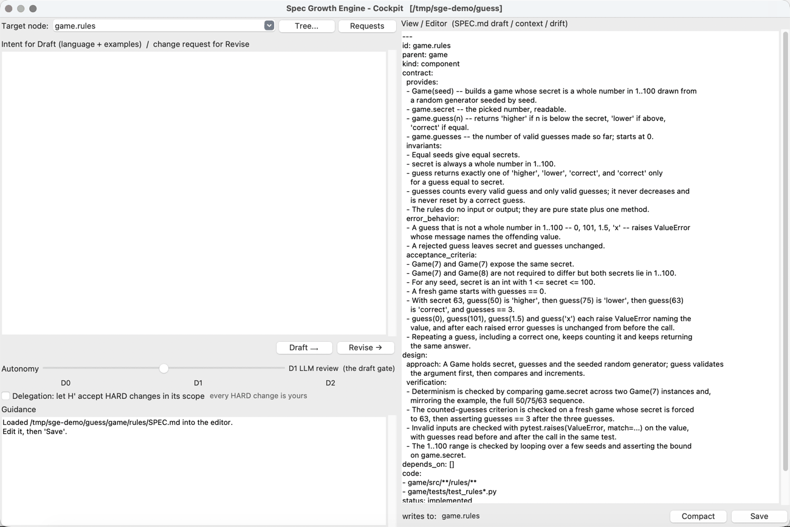

| Area | What it is |
|---|---|
| **Menus** | On macOS in the system menu bar at the top of the screen, not in the window: *Open, Node, Arch, Spec, Build, Validate, Registry* (Part 3). |
| **Target node** (top left) | The node everything acts on. Picking one loads its spec into the editor. **Tree...** opens the graph, **Requests** what waits for you. |
| **Intent box** | What you want, in plain words with examples -- for **Draft ⟶** -- or the change you want -- for **Revise →**. |
| **Autonomy / Delegation** | Two switches: who clears a spec draft (D0, D1, D2), and whether H' may accept one narrow kind of breaking change in an agent run. |
| **Guidance** (bottom left) | What just happened, and what to do next. Read it after every action. |
| **View / Editor** (right) | The spec you work on -- or a report or preview, read-only. |
| **writes to / Compact / Save** (under the editor) | The node **Save** writes to, and the two buttons that act on what the editor holds. |

## Part 2 -- Walkthrough: a number-guessing game

The program: the computer picks a secret number from 1 to 100; the player types
guesses; the game answers `higher`, `lower` or `correct -- N guesses`. Small enough
to follow every step, big enough for two components that depend on each other.

### Step 1 -- Lay the floor (Open > New Project...)

A project starts with a *floor*: the root node, the first container with its code
layout and build manifest, the rules that hold everywhere, and -- if an agent is
ever to build it -- the goal.

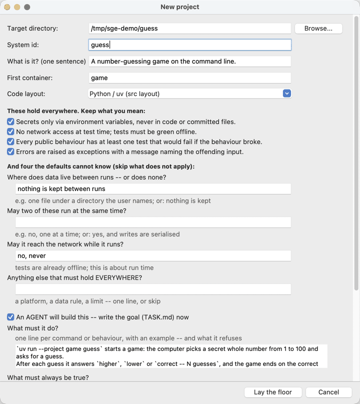

- **Target directory** -- an empty directory (here `/tmp/sge-demo/guess`).
- **System id** -- the name of the root node (`guess`).
- **What is it?** -- one sentence; it becomes the root's purpose.
- **First container** -- a deployable unit with its own language and build tool
  (`game`). **Code layout** decides where its code and tests live -- here
  Python with uv; the engine writes the matching `pyproject.toml`.
- **These hold everywhere** -- four rules every project starts with (secrets only
  from the environment, tests offline, every behaviour tested, errors name their
  input). Untick what you do not mean.
- **The four questions** -- what the defaults cannot know: where data lives, whether
  two instances may run at once, whether the program may use the network, anything
  else. Answer what applies; P turns each answer into a rule.

Tick **An AGENT will build this** and the goal appears: what the program must do,
what must always be true, what is out of scope -- one line each, in your words.

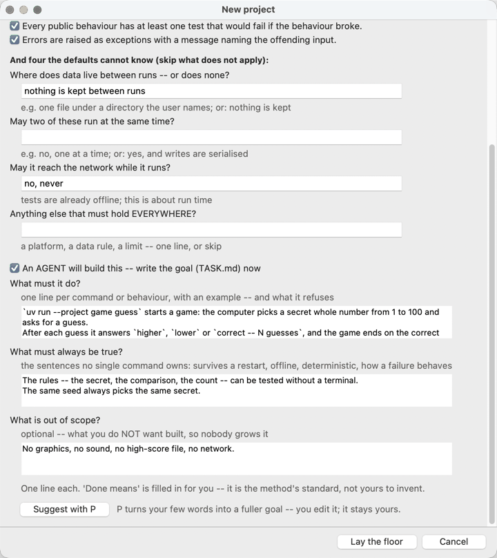

**Suggest with P** asks the planner to turn your few lines into a fuller goal.
It is a proposal in the dialog: read it, change what you mean differently -- it is
your goal, and nothing is written yet.

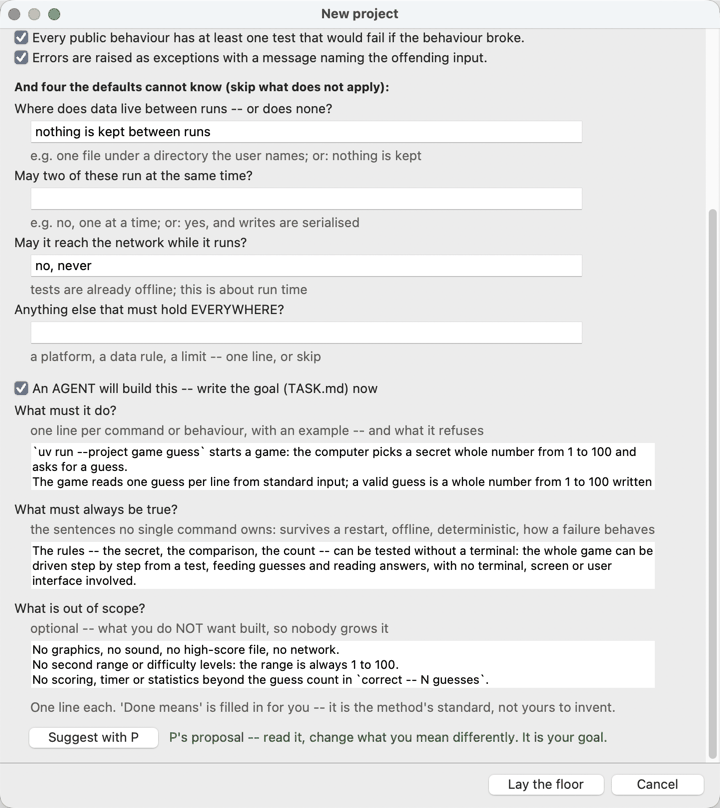

**Lay the floor** shows the plan first, and writes only when you say yes:

```text
This will write:

  /tmp/sge-demo/guess/SPEC.md            the root `guess`
  /tmp/sge-demo/guess/game/SPEC.md   the container, with its code layout
  /tmp/sge-demo/guess/ARCHITECTURE.md    6 invariant(s)
  /tmp/sge-demo/guess/TASK.md            the goal a run is measured against

and record all of it as the accepted state, so every later change
is measured against it.

Lay this floor?
```

The cockpit then opens the new project; Guidance lists what was written, and which
model plays which role.

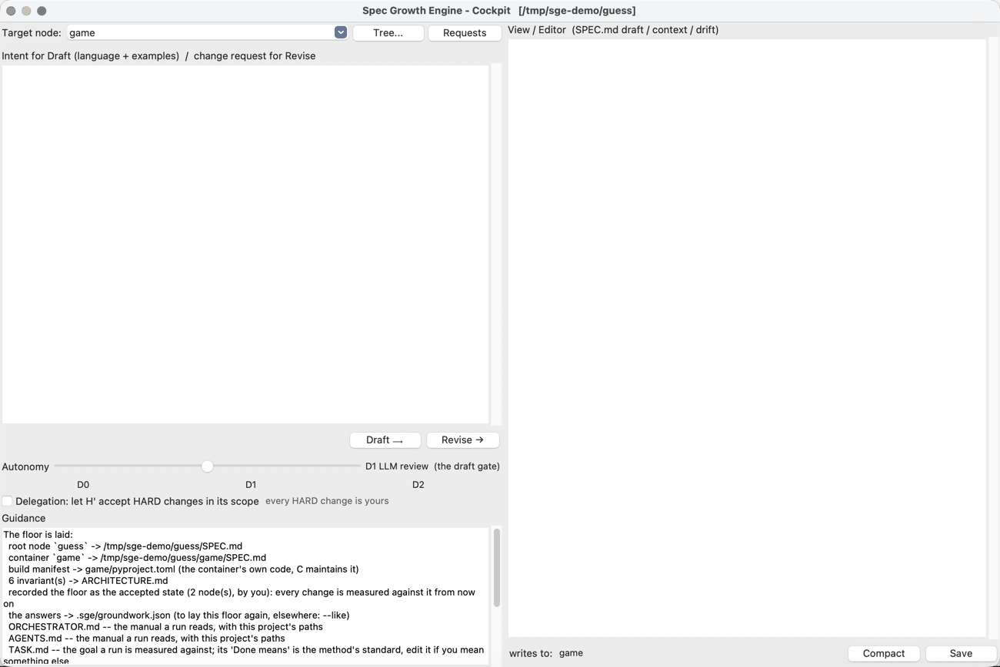

> **The accepted state.** From now on every change to a spec is measured against
> what was last accepted. A change is SOFT (it only adds, or nobody depends on it
> yet), HARD (it changes something another node relies on), AUTO (the engine
> checks it itself) or NONE (prose). What is SOFT the engine accepts; what is HARD
> is yours.

### Step 2 -- Read the goal (Build > Edit Goal (TASK.md)...)

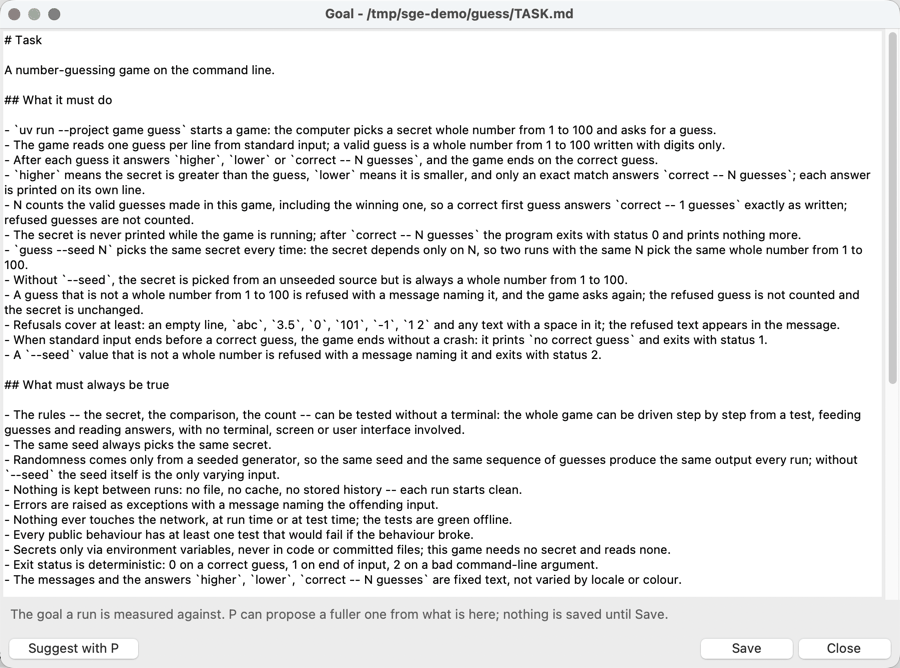

`TASK.md` is the yardstick a check or an agent run measures the result against.
It is yours: edit it here, **Save** writes it. Its *Done means* section is the
method's standard -- every behaviour tested, tests green offline, the gate passing.

### Step 3 -- Create the components (Node > New Node)

Two components: `rules` -- the game itself, testable without a terminal -- and
`cli` -- the command line that reads guesses and prints answers.

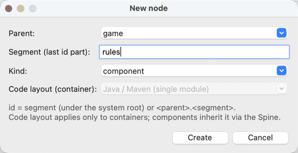

**Parent** is where it belongs, **Segment** is the LAST part of its id (`rules`
under `game` makes `game.rules`), **Kind** is `component`. A new node is an empty
skeleton; the next step fills it.

### Step 4 -- Draft the rules (Draft ⟶, then Save)

Pick `game.rules` in **Target node**, write in the **Intent box** what it is for --
with examples, because P derives the acceptance criteria from them -- and press
**Draft ⟶**:

```text
The rules of one game, with no terminal. Game(seed) picks a secret whole number
from 1 to 100 with a random generator seeded by `seed`; game.guess(n) returns
'higher', 'lower' or 'correct' and counts the guesses in game.guesses; a guess
that is not a whole number from 1 to 100 raises ValueError naming it, and is not
counted.
Examples: Game(7) and Game(7) have the same secret. If the secret is 63:
guess(50) -> 'higher', guess(75) -> 'lower', guess(63) -> 'correct', guesses == 3.
guess(0) and guess('x') raise.
```

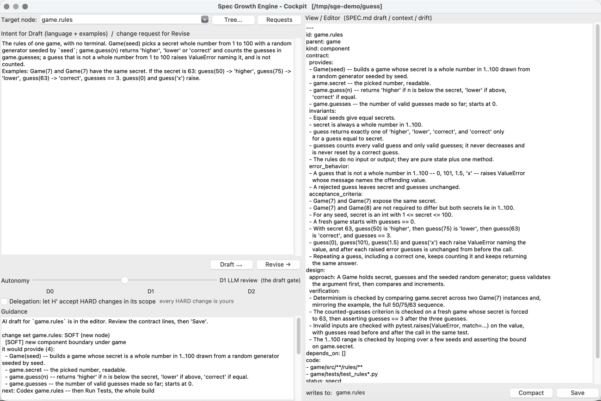

The draft is in the editor -- **not on disk**. Read it. Guidance says what saving
it would mean -- the *change set* -- and, because the slider stands at **D1**,
what H' found:

```text
change set game.rules: SOFT (new node)
  [SOFT] new component boundary under game
it would provide (3):
  - Game(seed) builds one game whose secret is a whole number in 1..100 ...
  - game.guess(n) compares n with the secret and returns 'higher' ...
  - game.guesses counts the guesses the game has accepted so far.
next: Codex game.rules -- then Run Tests, the whole build

H' review: APPROVE (confidence 0.72)
  [-] acceptance: Pin the boundary of 'whole number': add a case for 5.0 ...
  ...
```

The `next:` line says what follows: C codes this node, then the whole build is
tested. H''s findings are advice; you decide. Edit the draft if you like, then
press **Save** (under the editor -- *writes to:* names the node it writes):

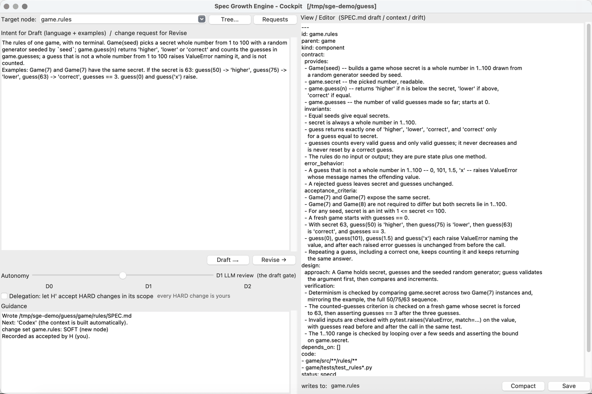

`Recorded as accepted by H (you)` -- what you save in the cockpit is accepted as
you save it.

### Step 5 -- Draft the command line

The same for `game.cli`, with its own intent: `guess [--seed N]` plays one game
with `game.rules`, reads one guess per line, prints the answers. P sees which
nodes exist and what they provide, so it declares on its own that the command
line *uses* the rules: `depends_on: [game.rules]`.

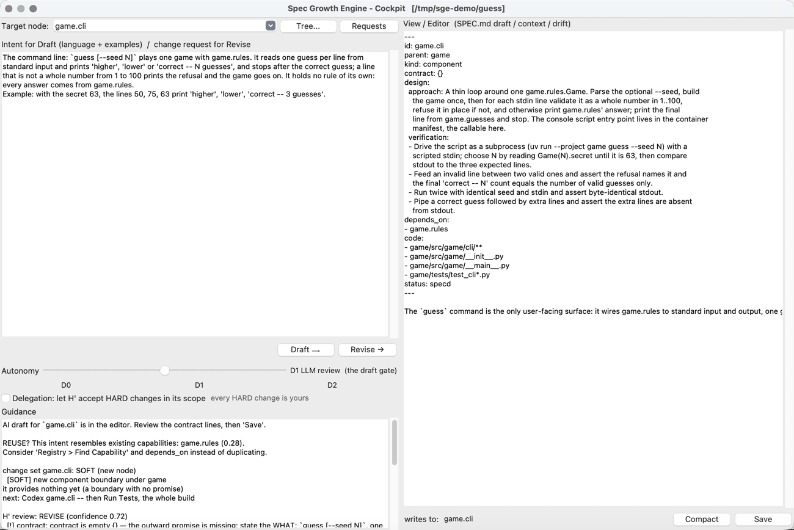

### Step 6 -- Look at the graph (Tree...)

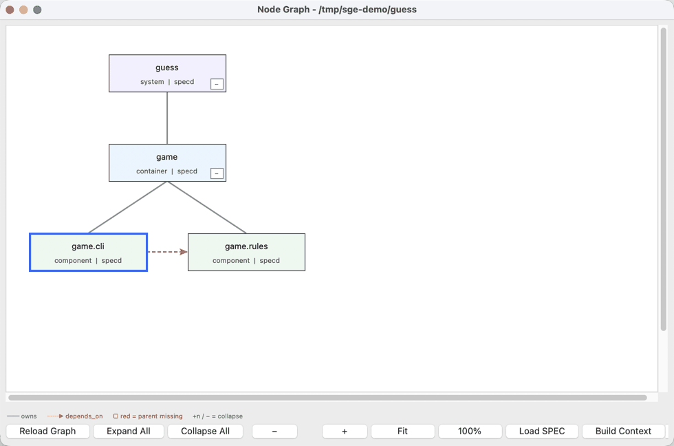

Ownership as grey lines, `depends_on` as a red dashed arrow, the target framed in
blue. Click a node to make it the target, double-click to load its spec.

### Step 7 -- Preview what C will get (Build Context)

Optional. **Build Context** shows, read-only, exactly what C will be given for the
target: the architecture, the contracts of everything above it, its own full spec,
its code so far, and the contracts of what it uses -- nothing else.

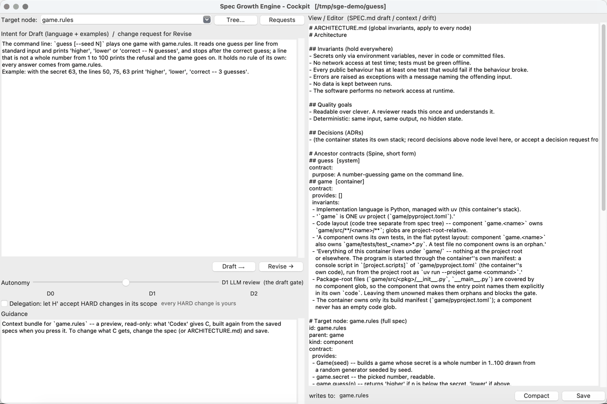

### Step 8 -- Let C write the code (Codex)

Pick `game.rules`, press **Build > Codex**. C builds the context itself, from the
saved specs, and implements *this node only* -- its code, its tests -- in the
container's build directory. The output streams into a window of its own; the
status line says whether C is still working.

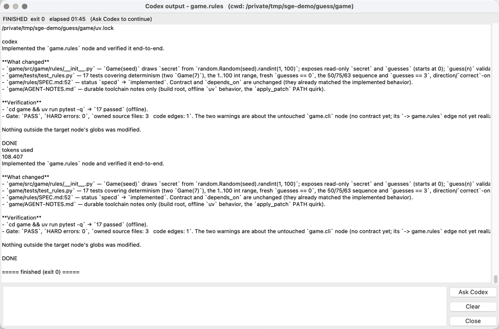

C reports what it changed and how it verified it -- here 17 tests, the gate
passing. Then the same for `game.cli`.

### Step 9 -- Build and test (Run Tests)

**Build > Run Tests** runs the project's tests -- the whole build, not one node --
and records the verdict as *test evidence*: a node is only `verified` with a
passing record.

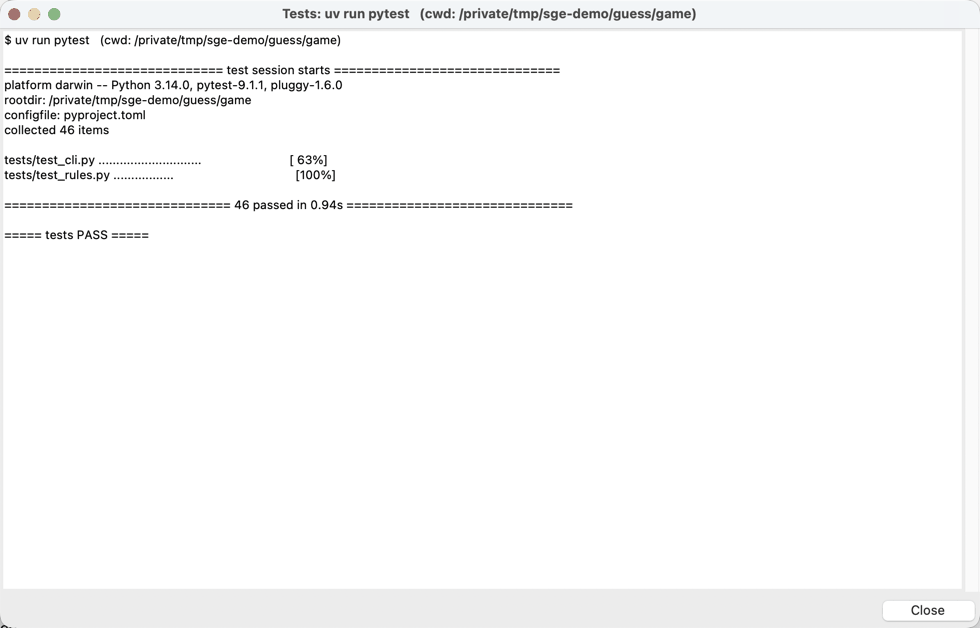

### Step 10 -- Check the structure (Validate > Gate)

**Validate** checks the spec side: does every spec fit the graph? **Drift** checks
the code side: does every file belong to exactly one node, and does code import
only what its spec declares? **Gate** runs both -- the same check the git hook
runs -- and on a pass the engine accepts every pending SOFT change, each shown
with its diff.

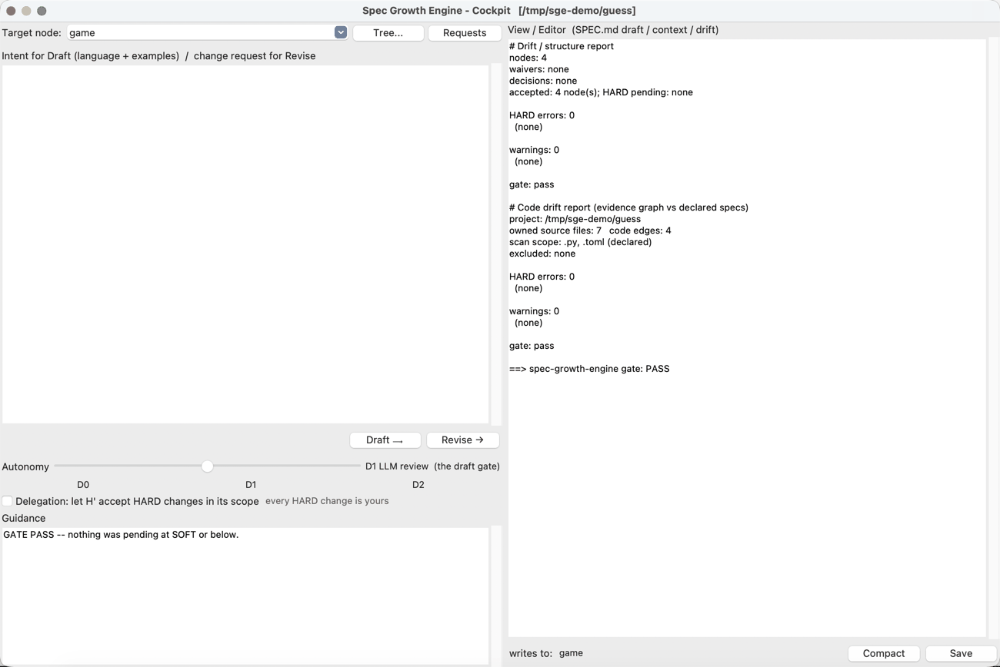

### Step 11 -- Does it meet the goal? (Build > Check Goal (TASK.md))

The tests pass and the gate passes -- but is the program what `TASK.md` asks for?
**Check Goal** answers that without an agent: E runs the tests and the gate, and
on a green floor H' reads the goal against the result. Guidance shows which step
it is in and for how long, because the call to H' can take a minute:

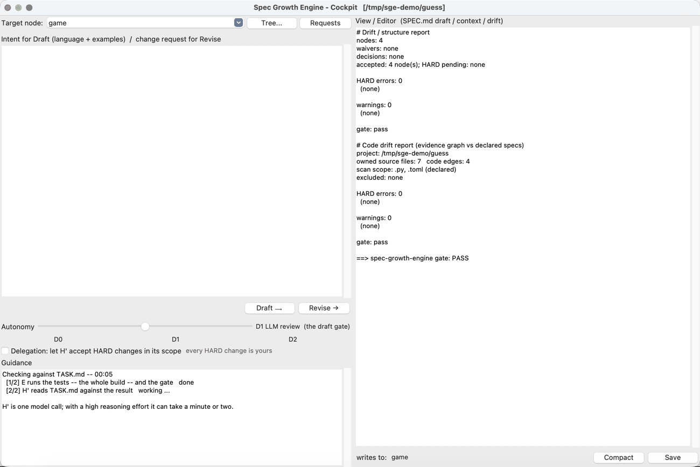

Here it found three gaps:

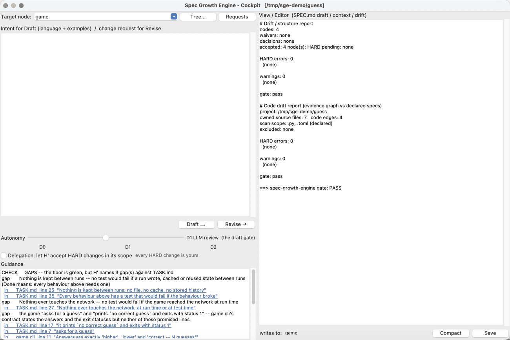

```text
CHECK     GAPS -- the floor is green, but H' names 3 gap(s) against TASK.md
gap       Nothing is kept between runs -- no test would fail if a run wrote,
          cached or reused state between runs
  in      TASK.md  line 25  "Nothing is kept between runs: no file, no cache, ..."
gap       Nothing ever touches the network -- no test would fail if the game
          reached the network at run time
  in      TASK.md  line 27  "Nothing ever touches the network, at run time ..."
gap       the game "asks for a guess" and "prints `no correct guess` and exits
          with status 1" -- game.cli's contract states neither
  in      TASK.md  line 17  "it prints `no correct guess` and exits with status 1"
  in      game.cli  line 11  "Answers are exactly 'higher', 'lower' and ..."
```

Each gap says **where it sits** -- the file, the line, the words. The `in` lines are
links: a click opens the place, the words marked:

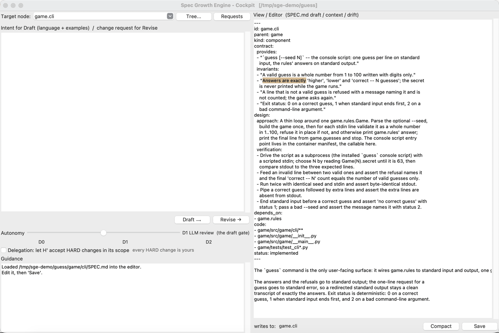

The verdicts: **done** (nothing missing, nothing waiting), **gaps** (with the list),
**asking** (something waits for you in Requests), **red** (tests or gate fail --
H' is not even asked), **unchecked** (H' not reachable).

### Step 12 -- Close the gaps (Revise →, Save, Codex Affected)

All three gaps are in the command line's contract and tests. Pick `game.cli`,
write the change in the **Intent box**, press **Revise →**:

```text
Close the three gaps Check Goal named. (1) The game asks for a guess: before each
read it prints the one line 'guess (1-100):'. (2) When standard input ends before
the correct guess it prints 'no correct guess' and exits with status 1 -- add both
lines to what the contract promises. (3) Add acceptance criteria with tests that
would fail if a whole game wrote, cached or kept a file between runs, or opened a
network connection. Nothing else changes.
```

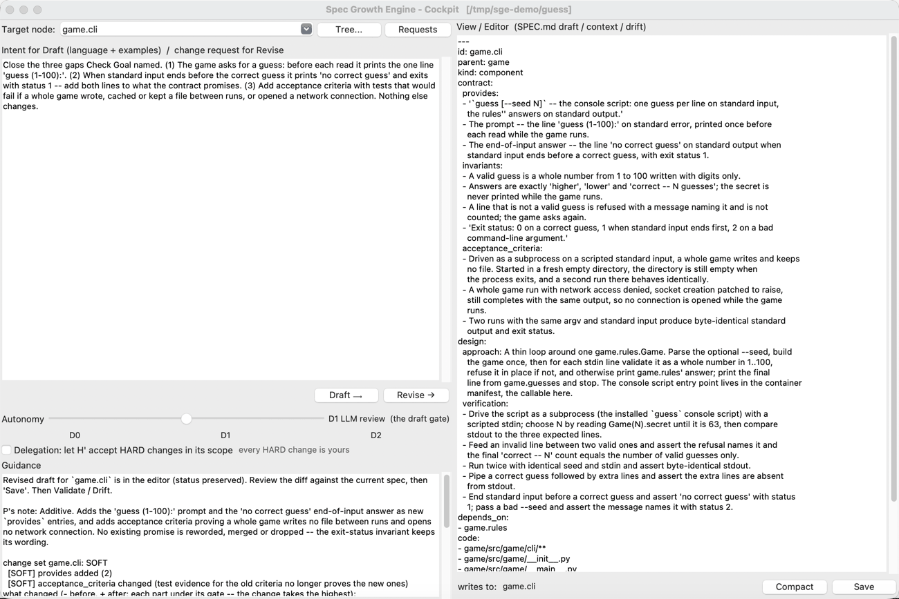

Revise changes the *saved* spec and keeps everything the request does not touch.
P says in a note what it changed and why, and the change set shows it entry by
entry -- `-` before, `+` after, each part under its gate:

```text
P's note: Additive. Adds the 'guess (1-100):' prompt and the 'no correct guess'
end-of-input answer as new `provides` entries, and adds acceptance criteria ...

change set game.cli: SOFT
  [SOFT] provides added (2)
  [SOFT] acceptance_criteria changed (test evidence for the old criteria no
         longer proves the new ones)
what changed (- before, + after; each part under its gate ...):
  [SOFT] provides
    + The prompt -- the line 'guess (1-100):' on standard error, ...
    + The end-of-input answer -- the line 'no correct guess' ... exit status 1.
  [SOFT] acceptance_criteria
    + Driven as a subprocess ..., a whole game writes and keeps no file. ...
    + A whole game run with network access denied ... still completes ...
next: Codex game.cli -- then Run Tests, the whole build
```

**Save**, then **Build > Codex Affected...**: C codes the node *and whoever uses
it*, dependencies first, then runs the tests and the gate -- the change set's
`next:` line, done for you. It shows the list before it starts:

```text
C implements, one after the other:
  1. game.cli
then the tests -- the whole build -- and the gate. It stops at the first node C
fails on.
```

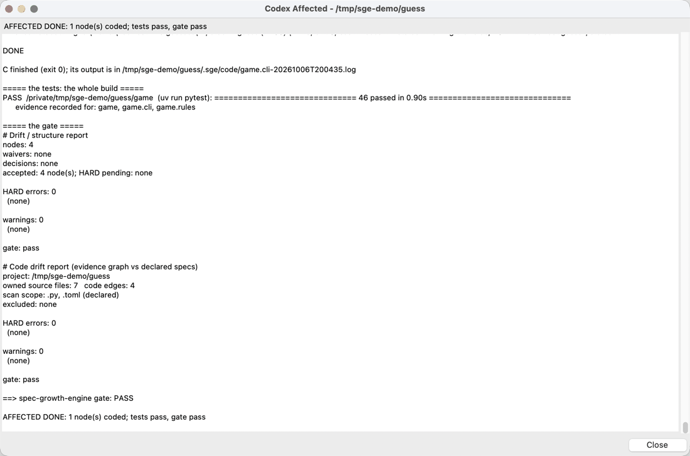

> **Why not just Codex?** For one node it is the same. When you change what
> others use -- say a function of `game.rules` -- Codex Affected codes
> `game.rules`, then `game.cli`, which calls it, in that order.

### Step 13 -- Check again, until it is done

**Check Goal** once more: the three gaps are closed -- and H', reading again, names
a smaller new one (without `--seed`, no test shows that the secret really varies).
That is normal: a check reads the whole goal every time. The same loop again --
Revise `game.cli`, Save, Codex Affected, Check Goal -- and:

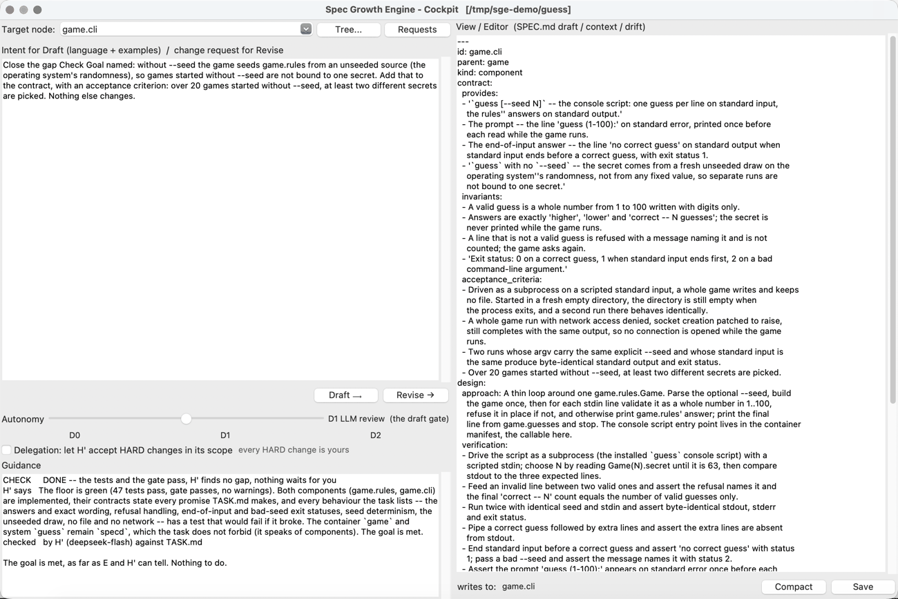

```text
CHECK     DONE -- the tests and the gate pass, H' finds no gap, nothing waits for you
H' says   The floor is green (47 tests pass, gate passes, no warnings). Both
          components (game.rules, game.cli) are implemented, their contracts state
          every promise TASK.md makes ... The goal is met.
```

The game is finished: `uv run --project game guess --seed 7` in the project.

### Step 14 -- What waits for you (Requests)

**Requests** (the button shows the count) lists everything only you may decide:
a node asking for a decision above it (a new rule in `ARCHITECTURE.md`, a change
to another node's contract), a requested waiver, a HARD change an agent left
pending. In this walkthrough nothing waited -- every change was yours or SOFT.

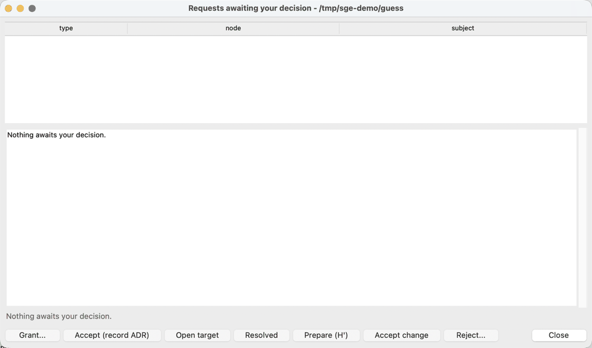

### Step 15 -- Keep specs short (Compact)

Specs written over many revisions grow. **Compact** (under the editor) asks P to
say the target's saved spec in fewer words: every promise kept, what is said twice
merged, what `ARCHITECTURE.md` already says dropped. Like a draft it lands in the
editor, unsaved:

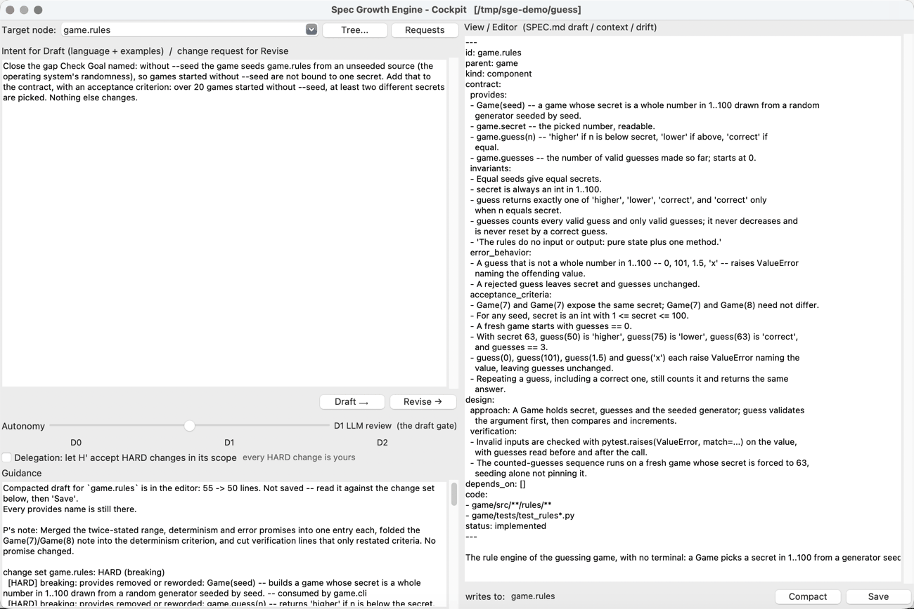

```text
Compacted draft for `game.rules` is in the editor: 55 -> 50 lines. Not saved --
read it against the change set below, then 'Save'.
Every provides name is still there.

change set game.rules: HARD (breaking)
  [HARD] breaking: provides removed or reworded: Game(seed) -- builds a game
         whose secret ... -- consumed by game.cli
  ...
```

Notice **HARD**: compacting *rewords* promises, and the engine reads contracts as
text -- a reworded promise that another node uses counts as broken until you look
at it. Read the `-`/`+` pairs; if nothing changed in substance, Save and accept.
(The Intent box is not used by Compact; it still holds the last request.)

### Step 16 -- Find things (Find in Specs, Cmd+F)

**Spec > Find in Specs...** (Cmd+Shift+F) searches `TASK.md`, `ARCHITECTURE.md`
and every spec at once; a double-click opens a hit with the words marked.

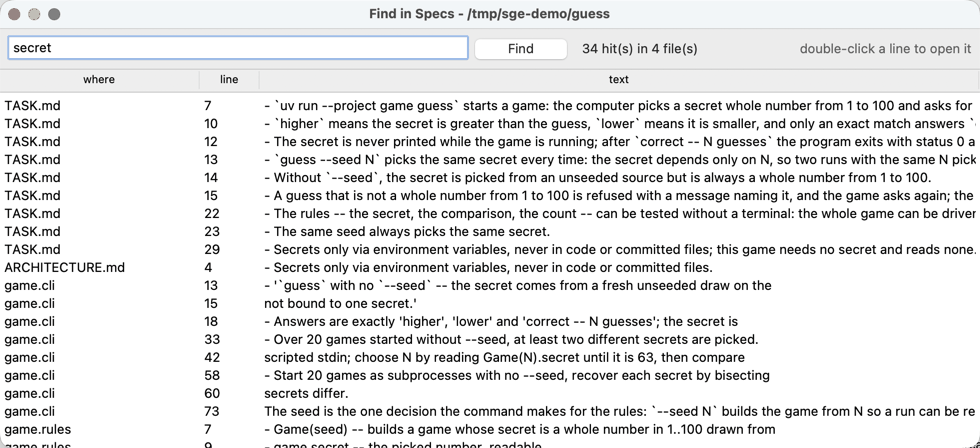

**Cmd+F** (Ctrl+F) finds in the text you are in -- every match marked, Enter for
the next:

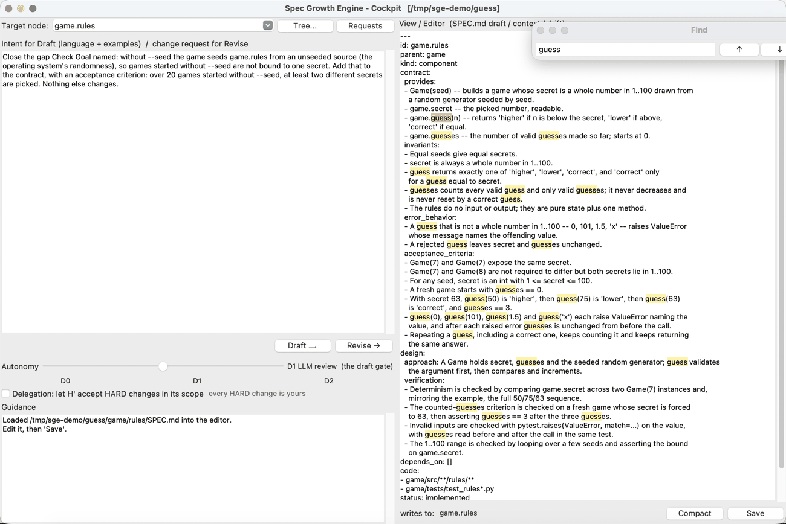

### Step 17 -- Rename a node (Node > Rename Node...)

You type the new last part of the id; the plan comes before anything moves:

```text
game.cli  ->  game.console

1 SPEC.md file(s) move, 2 are rewritten (id, parent, depends_on, children).
The code stays where it is.

Rename?
```

Every reference follows -- the parent's children, `depends_on` of every user --
and so do the accepted state and the test evidence: a rename moves no promise.
The code stays where it is; rename it too by revising the globs and letting C
move it. (In this walkthrough the answer was no.)

### Step 18 -- Let an agent build it (Build > Start Run...)

Everything above was done by hand, one button at a time. A *run* hands the
building to an agent: I reads `TASK.md`, drafts specs through P and code through
C, and after every round E measures and H' checks the goal -- until it is done,
or something waits for you.

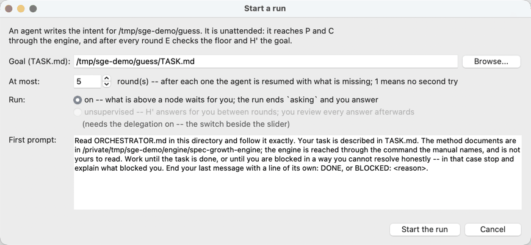

**At most** caps the rounds. **on** stops when something only you may decide comes
up; **unsupervised** lets H' answer such requests for you between rounds (every
answer stays yours to review) and needs the delegation on. The run's window shows
every step; closing it only hides it (**Build > Show Run Window** brings it back).

### Step 19 -- The rules that hold everywhere (Arch > Edit Arch)

`ARCHITECTURE.md` holds the invariants of the whole project, its quality goals and
its decisions (ADRs). It reaches every node through its context. **Edit Arch**
loads it into the editor, **Save Arch** writes it.

### Step 20 -- The two switches

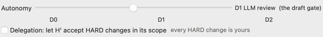

- **Autonomy (the draft gate)** -- who clears a spec *draft* in the cockpit:
  **D0** you alone; **D1** you, with a second opinion from H' (the default, used
  throughout this walkthrough); **D2** H' may save a small (SOFT) draft itself.
  A HARD change is yours at every setting.
- **Delegation** -- per project, off by default. On, H' may accept one narrow kind
  of HARD change in an agent run: a breaking change to a component contract whose
  consumers are all migrated.

## Part 3 -- Reference: every menu item and button

### The main window

| Control | What it does |
|---|---|
| **Target node** | The node everything else acts on. Picking one loads its `SPEC.md` into the editor -- unless the editor holds a spec nobody saved; then it asks first. |
| **Tree...** | Opens the node graph (also *Node > Show Tree*). |
| **Requests (n)** | Everything waiting for *you*: decision requests, waivers, pending HARD changes. |
| **Intent box** | What you want, in plain language with examples -- for Draft -- or the change you want -- for Revise. |
| **Draft ⟶** | P writes a fresh `SPEC.md` for the target from the intent. The draft lands in the editor, not on disk. |
| **Revise →** | P changes the target's *saved* spec as the Intent box asks, keeping everything it does not mention (and the status); a field you ask it to remove, it removes. P's note on what it changed and why appears above the change set. |
| **Autonomy slider (D0 / D1 / D2)** | The draft gate: who clears a spec draft -- you alone, you with a second opinion from H', or, for a small (SOFT) change, H' itself. |
| **Delegation** | Per project, off by default. On, H' may accept one narrow kind of HARD change in a *run*. |
| **Guidance** | What just happened and what to do next. Every action writes here. |
| **View / Editor** | The spec you work on -- or a report (Validate, Drift, Gate) or a preview (Build Context), read-only. |
| **writes to:** | The node Save writes to -- always the target. |
| **Compact** | P says the target's saved spec in fewer words; a draft, with a warning if a promise went missing. |
| **Save** | Writes the editor to the target's `SPEC.md`. A HARD change asks first, with the change set in front of you. What you save is accepted -- by you -- as you save it. |

Keyboard: **Cmd+F** (Ctrl+F) finds in the text that has the focus; **Cmd+Shift+F**
(Ctrl+Shift+F) is *Find in Specs*.

### Open

| Item | What it does |
|---|---|
| **Open** | Open another project: pick the directory that holds its root `SPEC.md`. |
| **New Project...** | Lay the floor of a new project in an empty directory (step 1). Nothing is written until you confirm the plan. |
| **New Project Like...** | The same floor again, in a new directory: the answers an earlier project was laid with, and its `TASK.md` as it reads now. |
| **Refresh Manuals** | Writes `AGENTS.md` and `ORCHESTRATOR.md` -- the manuals an agent run reads -- again from the method's templates. |
| **Reload** | Reads every `SPEC.md` from disk again (after you changed files outside the cockpit). |

### Node

| Item | What it does |
|---|---|
| **Show Tree** | The node graph (step 6). Click selects, double-click loads; Reload Graph, Expand All / Collapse All, zoom (− + Fit 100%), Load SPEC, Build Context. |
| **New Node** | A new node under a parent: the LAST part of the id, and the kind -- system, container or component (step 3). A container also gets a code layout. |
| **Rename Node...** | A new last id part for the target; the plan first (step 17). |
| **Delete Node** | Removes the target's `SPEC.md` (a subtree only if you confirm). Nodes that still depend on it are named. |

### Arch

| Item | What it does |
|---|---|
| **Edit Arch** | `ARCHITECTURE.md` into the editor (step 19). |
| **Save Arch** | Writes the editor to `ARCHITECTURE.md`. |

### Spec

| Item | What it does |
|---|---|
| **Load Spec** | The target's `SPEC.md` into the editor (picking the target does this already). |
| **Save Spec** | The same as the **Save** button. |
| **Compact Spec** | The same as the **Compact** button (step 15). |
| **Find in Specs...** | Words in `TASK.md`, `ARCHITECTURE.md` and every `SPEC.md` at once (step 16). |

### Build

| Item | What it does |
|---|---|
| **Build Context** | A read-only preview of what C gets for the target (step 7). |
| **Codex** | C implements the target -- only the target -- from that context, built fresh from the saved specs (step 8). In its window, *Ask Codex* sends a follow-up. |
| **Codex Affected...** | C implements the target and whoever uses it, dependencies first, then the tests and the gate (step 12). |
| **Run Tests** | The project's tests, the whole build; the verdict is recorded as test evidence (step 9). |
| **Edit Goal (TASK.md)...** | The goal, in an editor; *Suggest with P* proposes a fuller one (step 2). |
| **Check Goal (TASK.md)** | E runs the tests and the gate, H' checks the result against `TASK.md` -- no agent, nothing changed (step 11). |
| **Start Run...** | An agent grows the project from `TASK.md`, in rounds (step 18). |
| **Show Run Window** | The window of the run in progress -- or of the last one. |

### Validate

| Item | What it does |
|---|---|
| **Requests...** | The same as the **Requests** button (step 14). |
| **Validate** | The spec side: every `SPEC.md` parses and fits the graph -- parents, dependencies, cycles, waivers, requests, an earned status. |
| **Drift** | The code side: every file has exactly one owner, and code imports only what its spec declares. |
| **Gate** | Validate and Drift together -- the commit gate; on a pass E accepts every change at SOFT or below, each shown with its diff (step 10). |
| **Generate Index** | Writes `project.index.json`: the graph, the capabilities, the edges and the evidence, for tools. |
| **Install Git Hook** | Runs the gate on every `git commit` in the project. |

### Registry

| Item | What it does |
|---|---|
| **Find Capability** | Before you build something: does a node already provide it? |
| **Duplicates** | Nodes that probably provide the same thing twice. |
| **Claim Capability** | Records that you are about to build a capability, so a second claim on it is noticed. |

### The Requests window

| Button | What it does |
|---|---|
| **Grant...** | Grant a requested waiver: an owner and an expiry -- only you grant. |
| **Accept (record ADR)** | Accept a decision request aimed at `ARCHITECTURE.md`: written there as a dated decision. |
| **Open target** | Load the node a decision request wants changed, with the change prepared in the Intent box for Revise. |
| **Resolved** | You changed the target yourself: remove the request. |
| **Prepare (H')** | H' writes a brief for a pending HARD change: what changes, whom it reaches. |
| **Accept change** | Accept a pending HARD change: it becomes the accepted state. |
| **Reject...** | Reject a request or a HARD change, with a reason the agent will read. |

## Where to read on

- [README.md](README.md) -- the cockpit's full manual: every mechanism, every file.
- [../spec-growth-engine/SPEC-GROWTH-ENGINE.md](../spec-growth-engine/SPEC-GROWTH-ENGINE.md)
  -- the method: nodes, contracts, gates, the lifecycle.
- [../spec-growth-engine/AUTONOMY.md](../spec-growth-engine/AUTONOMY.md) -- the
  switches, agent runs, and what is delegated to whom.
