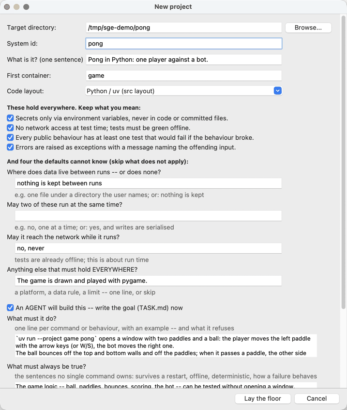
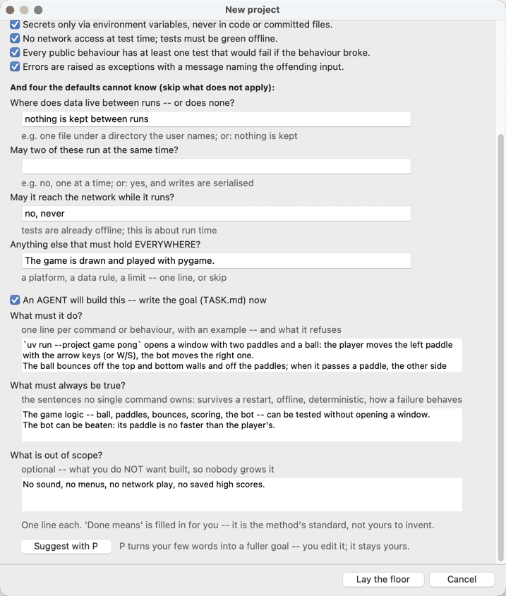
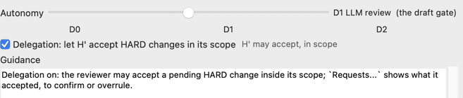
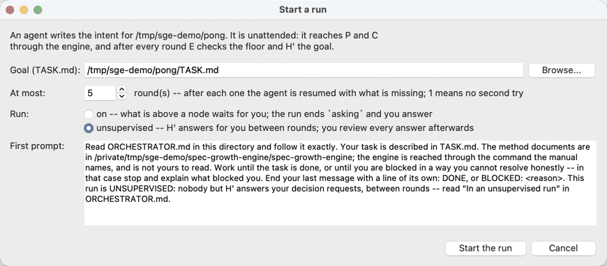
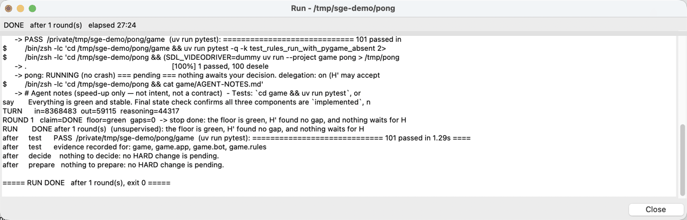
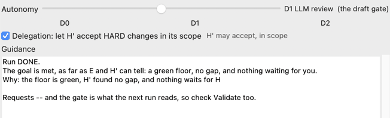
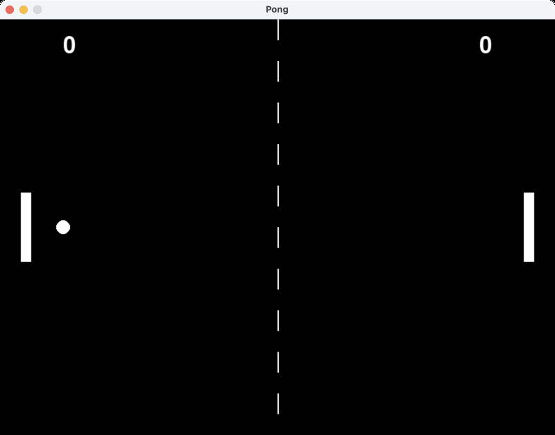

# Quick start: Pong in one run

> Part of the [Spec Growth Engine](../README.md). The cockpit step by step, button by button: [MANUAL.md](MANUAL.md).

One goal, one unsupervised run, a game to play. The pictures are from a real run
-- all four roles on DeepSeek, about half an hour; the roles must be set first
([Models and keys](../README.md#models-and-keys)).

**1. Lay the floor and write the goal.** In the cockpit, **Open > New
Project...**: a directory, a name, the first container `game` in the Python/uv
layout. Three of the four questions are answered -- nothing is kept, no network,
and *the game is drawn and played with pygame* -- and with *An AGENT will build
this* ticked, the goal is typed in a few lines.





**Lay the floor** writes the root, the container with its build manifest,
`ARCHITECTURE.md` with the seven invariants, the agent's manuals -- and the goal,
`TASK.md`:

```markdown
# Task

Pong in Python: one player against a bot.

## What it must do

- `uv run --project game pong` opens a window with two paddles and a ball: the player
  moves the left paddle with the arrow keys (or W/S), the bot moves the right one.
- The ball bounces off the top and bottom walls and off the paddles; when it passes a
  paddle, the other side scores a point and the ball is served again from the centre.
- The score is shown at the top. The first to 5 points wins: the window says who won,
  Space starts a new match, Escape quits.

## What must always be true

- The game logic -- ball, paddles, bounces, scoring, the bot -- can be tested without
  opening a window.
- The bot can be beaten: its paddle is no faster than the player's.

## Out of scope

- No sound, no menus, no network play, no saved high scores.
```

(`TASK.md` also gets the method's standard *Done means*.)

**2. Let it run on its own.** Tick **Delegation** -- the reviewer H' may then
accept a breaking change once every consumer is migrated -- and start
**Build > Start Run...** as *unsupervised*: what an agent would ask you, H'
answers between rounds, and you review every answer afterwards.





**3. Wait.** The run window shows what the agent does. This run grew three
components -- `game.rules` (the game without a window), `game.bot` and
`game.app` (the pygame window) -- and ended after one round, in 27 minutes:
101 tests green, the gate passing, no gap against `TASK.md`, nothing waiting for
a decision.





**4. Play** -- from the project directory:

```sh
uv run --project game pong
```



The same without the cockpit, from this directory:

```sh
uv run python cli.py init ~/pong --id pong --container game \
    --purpose "Pong in Python: one player against a bot." \
    --invariant "Nothing is kept between runs." \
    --invariant "The system never reaches the network while it runs." \
    --invariant "The game is drawn and played with pygame." \
    --does "\`uv run --project game pong\` opens a window with two paddles and a ball: the player moves the left paddle with the arrow keys (or W/S), the bot moves the right one." \
    --does "The ball bounces off the top and bottom walls and off the paddles; when it passes a paddle, the other side scores a point and the ball is served again from the centre." \
    --does "The score is shown at the top. The first to 5 points wins: the window says who won, Space starts a new match, Escape quits." \
    --always "The game logic -- ball, paddles, bounces, scoring, the bot -- can be tested without opening a window." \
    --always "The bot can be beaten: its paddle is no faster than the player's." \
    --not-this "No sound, no menus, no network play, no saved high scores."
uv run python cli.py delegate ~/pong on
uv run python cli.py run ~/pong --unsupervised
cd ~/pong && uv run --project game pong
```

A run is a real model run: another one grows a different graph, and it may end
asking instead of done -- with what it needs from you in **Requests...**.
